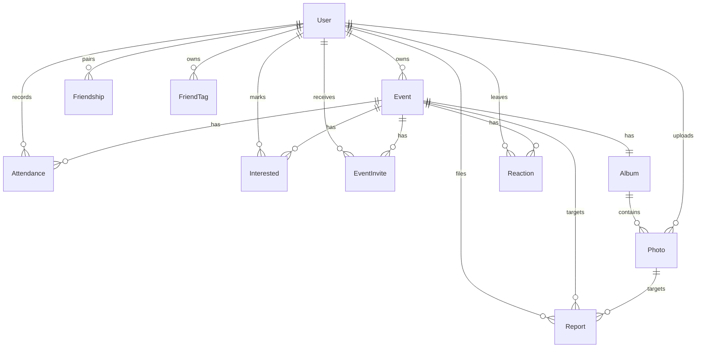

# 0003. Data model

- Status: Accepted
- Date: 2026-11-16

## Context

The product model is the Base44 entities (User, Event, Attendance, EventInterest, EventPhoto, Friend, FriendTag, Report) plus the inventory rules: mutual friends, owner-private tags, visibility, approval, a separate Interested signal, and albums. The rebuild adds real keys, a PostGIS point, and an IANA zone. Event status in the old app was easy to confuse with a stored flag.

## Decision

Every table has a uuid primary key. Instants are `timestamptz` in UTC. Event status is computed and never stored.

- Upcoming: `now < start_at`
- Happening now: `start_at <= now < end_at`
- Ended: `now >= end_at`

**User.** Internal `id`, plus `issuer` and `sub` from the IdP (unique together). Profile: `display_name`, `email`, `profile_photo_url`, `language` (`en` or `pt-BR`).

**Event.** `owner_id`, `title`, `description`, `start_at`, `end_at`, `time_zone_id` (IANA), `location geometry(Point,4326)`, `address`, `visibility` (`public`, `unlisted`, `friends_only`), `share_token` (128-bit), `approval_mode` (`open`, `approval`), optional cover, and tags from the fixed set: Music, Sports, Food, Art, Family, Tech, Nightlife, Outdoor, Culture, Education. `end_at` is after `start_at`, and the span is at most 7 days. The UI shows `address`. The point is for queries and pins.

**Attendance.** Unique `(event_id, user_id)`. State: `attending`, `requested`, `rejected`, `cancelled`. `open` joins as `attending`. `approval` joins as `requested` until the owner approves or rejects.

**Interested.** Unique `(event_id, user_id)`, separate from Attendance. It grants nothing else.

**Friendship.** Mutual. One row per unordered pair, so a one-sided acceptance cannot exist. Accepting an invite link inserts that row.

**FriendTag.** `owner_id`, `friend_user_id`, tags. Readable only by the owner. Used to pick invitees.

**EventInvite.** `event_id` and invitee. A friends-only create writes one invite per friend whose tags match, and an Attendance row in `attending` or `requested` according to `approval_mode`.

**Album and Photo.** One album per event. A photo belongs to that album and records `uploader_id` and a private blob reference. The cover stays on the event, not in the album.

**Report.** `reporter_id`, target (`event` or `photo`), and a fixed reason: `inappropriate_content`, `spam_scam`, `fake_misleading`, `harassment_unsafe`. No free text.

**Reaction.** Unique `(event_id, user_id)`. Type: `loved_it`, `fun`, or `would_go_again`. The owner or `attending` may set it once `now >= start_at`. Counts are aggregates only.

## Consequences

- Happening-now pills, the pin pulse, and discovery all use the same predicate. An event leaves "now" at `end_at`.
- Create inserts the owner as `attending`, matching the product rule, so album and past-event checks read one row.

## Open

- Create-time strictness. `end_at` in the past is rejected. "Start now" sets `start_at` to save time. Whether any other past `start_at` is rejected is open.
- After `cancelled`, may the user attend again before `end_at`? After `rejected`, may they request again? May anyone attend once the event has ended? If the owner retags friends later, do existing events gain new invites?
- Report workflow. Rows are stored. Who reviews them, and who can still see an event after the soft-hide threshold of three unique reports, is open. `VisibleTo` does not apply soft-hide until that is decided ([ADR 0007](0007-privacy-enforcement.md)).
