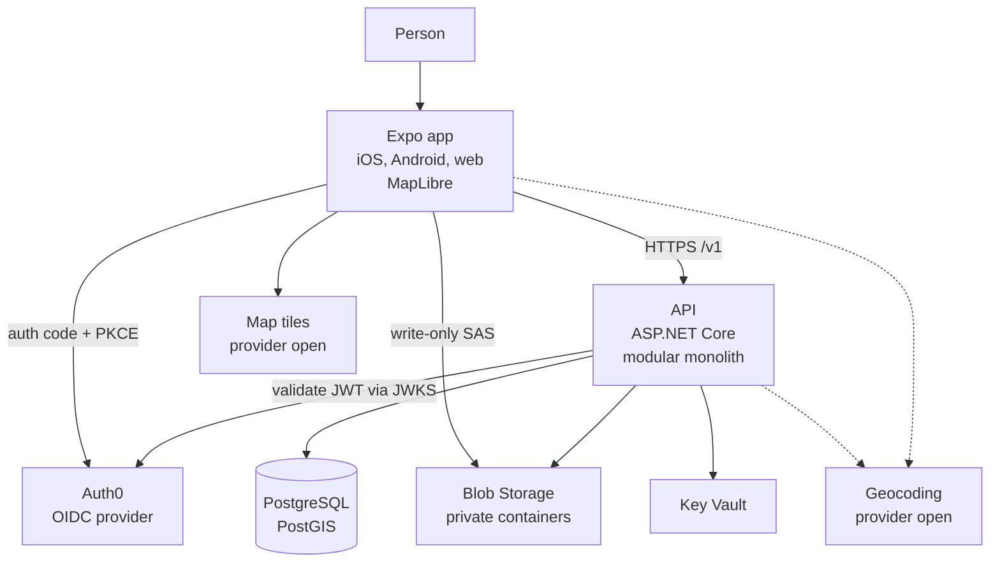

# Happengo architecture baseline

Happengo's product vision includes local incident awareness, nearby event discovery, and private gathering memories, with location, time, and audience as shared concepts. See the [product vision](../product-vision.md). This architecture baseline currently covers the social-event and map-discovery foundation; incident reporting, private albums, and external live-stream links are not implemented. One Expo client (iOS, Android, and web) calls one ASP.NET Core API. The API is a modular monolith on PostgreSQL/PostGIS. Azure is planned for Container Apps (consumption plan, scale to zero) with Blob Storage and Key Vault.

Anonymous visitors can browse public events that have not ended. Sign-in is required to create events, attend, manage friends, and use albums. v1 is one codebase, one API process, local development, and one deployed environment.

Geocoding is behind one adapter. Whether that adapter runs in the API or the client is open with the provider choice ([ADR 0006](../adr/0006-geo-queries.md)).

## ADR index

| ADR | Title | Status |
|---|---|---|
| [0001](../adr/0001-repo-layout-ts-client-map-stack.md) | Repo layout, TypeScript client, and map stack | Accepted |
| [0002](../adr/0002-stack-and-modular-monolith.md) | Stack and modular monolith | Accepted |
| [0003](../adr/0003-data-model.md) | Data model | Accepted |
| [0004](../adr/0004-backend-baseline.md) | Backend baseline | Accepted |
| [0005](../adr/0005-authentication.md) | Authentication | Accepted |
| [0006](../adr/0006-geo-queries.md) | Geo queries | Accepted |
| [0007](../adr/0007-privacy-enforcement.md) | Privacy enforcement | Accepted |
| [0008](../adr/0008-image-storage.md) | Image storage | Accepted |
| [0009](../adr/0009-i18n.md) | Internationalization | Accepted |

All listed ADRs are accepted.

## Open for Brenner

- Geocoding provider — [ADR 0006](../adr/0006-geo-queries.md)
- Tile provider for MapLibre — [ADR 0006](../adr/0006-geo-queries.md)
